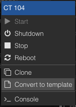
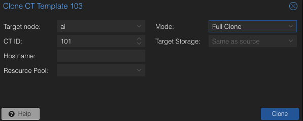

# How to create Proxmox LXC containers with nvidia GPU permissions
Scripts for creating Proxmox VE LXC containers with nvidia GPU permissions based on [jocke's guide to Plex GPU transcoding](https://jocke.no/2025/04/20/plex-gpu-transcoding-in-docker-on-lxc-on-proxmox-v2/).

These were _absolutely_ vibe-coded (using Gemini) as my sed, awk, and grep skills are pretty rusty. The scripts now target Proxmox VE 9 with Debian 13 (Trixie). The NVIDIA installers also detect Debian 12 (Bookworm), so they keep working on PVE 8 hosts and existing Bookworm containers.

## Proxmox setup prior to containers

The NVIDIA packages come from NVIDIA's CUDA repository. The scripts also enable the `non-free` and `non-free-firmware` components so Debian's own NVIDIA-related packages and firmware remain available. Proxmox VE 9 uses the deb822 format (`/etc/apt/sources.list.d/debian.sources`), while older installations still use `/etc/apt/sources.list`; `update_debian_sources.sh` handles both and leaves Proxmox, Docker, and other third-party repositories alone.

On the Proxmox host, run the host driver installer:

```bash
curl -fsSL -o- https://raw.githubusercontent.com/dmbeta/create-proxmox-nvidia-containers/main/install_nvidia_driver_on_host.sh | bash
reboot now
```

The script detects the Debian release, selects the matching CUDA repository (`debian12` or `debian13`), installs `proxmox-default-headers`, and builds `nvidia-driver-cuda` plus `nvidia-kernel-dkms`. If the running kernel is an opt-in kernel, it also installs the headers for that exact kernel. Pass `--reboot` to the script if you want it to reboot automatically, for example with `curl ... | bash -s -- --reboot`. Verify the result with `nvidia-smi` after the reboot.

> **Kernel headers:** `proxmox-default-headers` tracks the headers for the default Proxmox kernel. `pve-headers` still exists, but it is a transitional package that depends on `proxmox-default-headers`. The host installer checks for `/lib/modules/$(uname -r)/build` and installs `proxmox-headers-$(uname -r)` when needed, so opt-in kernels work without manual header handling. If the exact headers package is unavailable from your configured repositories, install it manually or boot the default kernel:
>
> ```bash
> apt install proxmox-headers-$(uname -r)
> ```

## Creating the container
1. Create a new LXC container with the following options:
    - Container type: Container
    - OS: Debian
    - Version: 13 (Trixie)

    But do not start it just yet.

2. Add the necessary cgroup2 devices and lxc mount points to the container's configuration file. You can generate them by utilizing the generate_lxc_conf_additions.sh script by running:

    ```bash
    # run on the host
    curl -fsSL -o- https://raw.githubusercontent.com/dmbeta/create-proxmox-nvidia-containers/main/generate_lxc_conf_additions.sh | bash
    ```

    and then copy the output to the container's configuration file, usually located at /etc/pve/lxc/<container_id>.conf.

    NOTE: All following commands can be run from the container, or pushed to the container by running on the host with the command copied inside like so:

    ```bash
    pct exec <container_id> -- sh -c "<command>"
    ```

3. Start the container and then run the following command inside to install the NVIDIA driver on the container. The script installs `sudo` and `curl` if needed, detects Debian 12 or 13, selects the matching CUDA repository, and reboots the container when it finishes.

    ```bash
    curl -fsSL -o- https://raw.githubusercontent.com/dmbeta/create-proxmox-nvidia-containers/main/install_nvidia_driver_on_container.sh | bash
    ```

    Everything after this step is optional if you just needed an LXC container with the NVIDIA driver installed but didn't want to install docker and the NVIDIA Container Toolkit.

4. (Optional) Install docker and the NVIDIA Container Toolkit on the container. This is required for running NVIDIA containers on the container.

    ```bash
    curl -fsSL -o- https://raw.githubusercontent.com/dmbeta/create-proxmox-nvidia-containers/main/install_docker.sh | bash
    ```

    ```
    curl -fsSL -o- https://raw.githubusercontent.com/dmbeta/create-proxmox-nvidia-containers/main/install_nvidia_container_toolkit.sh | bash
    ```

5. (Optional) Set up a cron job to delete unused images, containers, and volumes. This helps keep the container size down.

    ```bash
    crontab -e # open the crontab file
    ```

    Add the following lines to the crontab file to run the commands at 10:00 AM every day.

    ```cron
    0 10 * * * docker container prune -f > /dev/null 2>&1
    0 10 * * * docker image prune -f > /dev/null 2>&1
    0 10 * * * docker volume prune -f > /dev/null 2>&1
    0 10 * * * docker network prune -f > /dev/null 2>&1
    0 10 * * * docker builder prune -f > /dev/null 2>&1
    ```

6. (Optional) Configure unattended-upgrades for the container while disabling unattended-upgrades for nvidia driver updates. This is so that you can keep the container up to date with the latest security updates, but nvidia driver updates require a different approach to avoid conflicts with the host.

    ```bash
    curl -fsSL -o- https://raw.githubusercontent.com/dmbeta/create-proxmox-nvidia-containers/main/install_unattended_upgrades_on_container.sh | bash
    ```

7. (Optional, but recommended): Once you verify the container works using `nvidia-smi` and a sample container, turn it into a template. This will allow you to easily create new containers from this template.

    ```bash
    rm /etc/ssh/ssh_host_*
    truncate -s 0 /etc/machine-id
    shutdown now
    ```

    In the UI, right click the (now stopped) container, and select "Convert to template". This requires that there are no snapshots of the container, and you won't be able to run the container after converting to a template.

    

    You can then create new containers from this template by right clicking the template and selecting clone. When cloning, change mode to "Full Clone".

    


# Upgrade an Existing PVE 8 / Debian 12 Installation to PVE 9 / Debian 13

`upgrade_to_pve9.sh` is a staged helper for the major distribution upgrade. It is **not** a replacement for the official [Upgrade from 8 to 9](https://pve.proxmox.com/wiki/Upgrade_from_8_to_9) guide or for tested backups. Read the official guide before starting.

The script:

- updates the host to the latest PVE 8.4 packages and runs `pve8to9 --full`;
- switches the Debian and Proxmox repositories to Trixie, and the NVIDIA CUDA repository to `debian13`;
- stops running containers during `prepare`, then upgrades the Debian 12 containers it restarts and creates a snapshot before each one;
- never reboots automatically;
- refuses Ceph nodes and unhealthy clusters, and requires explicit flags or confirmation for cluster nodes and running VMs.

Requirements:

- PVE 8.4.x, root access, and a working console/IPMI (or `tmux`/`screen`). Do **not** run the upgrade from the Proxmox GUI virtual console.
- Tested backups of every VM and container. The script asks you to confirm this.
- At least 10 GB free on `/`, ideally more.
- In a cluster, upgrade one node at a time and pass `--allow-cluster`. Make sure the cluster is quorate and healthy first.
- Ceph nodes are not supported by this script. Upgrade Ceph separately with the official Ceph guide.

Download the script to the host and run the read-only check:

```bash
curl -fsSL -o /root/upgrade_to_pve9.sh https://raw.githubusercontent.com/dmbeta/create-proxmox-nvidia-containers/main/upgrade_to_pve9.sh
chmod +x /root/upgrade_to_pve9.sh
/root/upgrade_to_pve9.sh check
```

Then start the host upgrade:

```bash
/root/upgrade_to_pve9.sh prepare --backups-confirmed
```

`prepare` stops all running containers, records their IDs, updates PVE 8, and runs the `pve8to9` checker. If it installs a new kernel or requests a reboot, reboot the host and run the same `prepare` command again. Once the PVE 8 side is ready, it switches the apt repositories and runs `apt dist-upgrade` to PVE 9.

After `prepare` completes, reboot and finish the NVIDIA installation:

```bash
reboot
/root/upgrade_to_pve9.sh host-nvidia
reboot
/root/upgrade_to_pve9.sh containers
```

`host-nvidia` installs the `debian13` CUDA keyring, `proxmox-default-headers` plus any headers needed for an opt-in running kernel, and the NVIDIA driver, then verifies the DKMS module for the running kernel. `containers` restarts the containers recorded during `prepare`, upgrades each running Debian 12 container to Debian 13, reinstalls the NVIDIA userspace driver when a GPU device is present, reboots the container, and verifies `nvidia-smi`.

Container rollback, if needed:

```bash
pct stop <container_id>   # if it is still running
pct rollback <container_id> pre-debian13-<timestamp>-<container_id>
pct start <container_id>
```

Snapshots are kept until you remove them with `pct delsnapshot <container_id> <snapshot>`. If your storage does not support container snapshots, use `--no-snapshot` only when you have a separate tested backup.

Useful options:

| Option | Purpose |
| --- | --- |
| `--repo enterprise` or `--repo no-subscription` | Override Proxmox repository detection. |
| `--allow-cluster` | Allow a quorate cluster node. |
| `--allow-running-vms` | Continue with running VMs (not recommended). |
| `--force-low-space` | Continue with less than 10 GB free. |
| `--accept-unknown-repos` | Continue after reviewing third-party repositories that still point at Bookworm. |
| `--no-snapshot` | Do not create container snapshots. |

The script logs to `/var/log/pve9-upgrade-*.log` and stores its stage in `/var/lib/pve-nvidia-upgrade/state`. Containers that were already stopped before `prepare` are skipped by the container stage; start and upgrade them manually afterwards.

# Refresh the NVIDIA Driver on Host and Containers

This is the routine driver refresh for an installation that is already on PVE 9 / Debian 13. It is **not** the PVE 8 -> 9 upgrade. The script assumes all running containers are using the GPU; stop containers that do not use it. It refreshes the Proxmox and NVIDIA packages on the host, including headers for the running opt-in kernel, upgrades packages in the running containers, restarts the containers, and then restarts the host.

```bash
# please run this on the Proxmox host
curl -fsSL -o- https://raw.githubusercontent.com/dmbeta/create-proxmox-nvidia-containers/main/upgrade_host_and_containers.sh | bash
```

# Other Useful Sources

- [Proxmox VE Helper-Scripts](https://community-scripts.github.io/ProxmoxVE/scripts)
- [Habitats Open Tech's Guide to Proxmox](https://portal.habitats.tech/Proxmox+VE+8+(PVE)/1.+PVE+8.x+-+Introduction)

## Cool Tools

- [Beszel](https://github.com/henrygd/beszel) for monitoring both Proxmox and LXC containers resource utilization. 
  - It has helped me with discovering that my LXC containers were running out of disk space.
- [Dockge](https://github.com/louislam/dockge) a docker compose manager.
- [Tailscale](https://tailscale.com/). I'd be surprised if you hadn't heard about this. It's a VPN that allows you to connect to your Proxmox host and your containers from anywhere.
    - I set up Tailscale in each of my containers like so:
        ```sh
        curl -fsSL https://tailscale.com/install.sh | sh
        sudo tailscale set --auto-update
        sudo tailscale up --ssh --accept-routes
        ```
        This allows you to SSH into your container without having to port forward or manage ssh keys.
    - One important note though, is that your LXC container must either be privileged _or_ have the following line in its `/etc/pve/lxc/<container_id>.conf` file:
        ```yaml
        lxc.mount.entry: /dev/net dev/net none bind,create=dir
        lxc.cgroup2.devices.allow: c 10:200 rwm # this must correspond to the ids you see when you run `ls -l /dev/net`
        ```
    - Another important note, is you should _NOT_ run `tailscale up` in a container that you intend to turn into a template. This is because subsequent copies of the container will not generate a new tailscale [node key](https://tailscale.com/kb/1010/node-keys). I'd recommend running the install and autoupdate steps in the container, follow the steps above to convert the container to a template, and then run `tailscale up` on a fresh copy of the template.
    - [Official Tailscale LXC Documentation](https://tailscale.com/kb/1130/lxc-unprivileged)